<p align="center">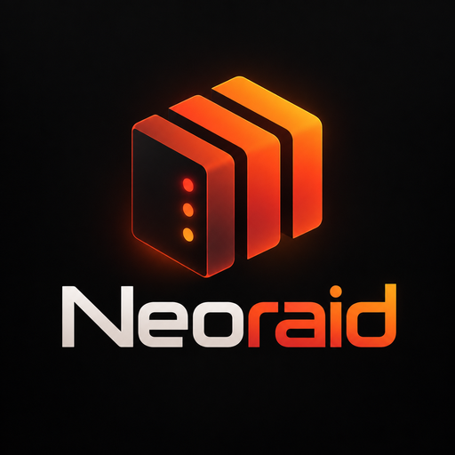</p>

# Neoraid

A modern theme for the **Unraid 7.3** webGUI that keeps the Unraid palette. It is a plugin that adds a stylesheet layer on top of the stock theme: no system file is changed, and removing the plugin brings back the original look.

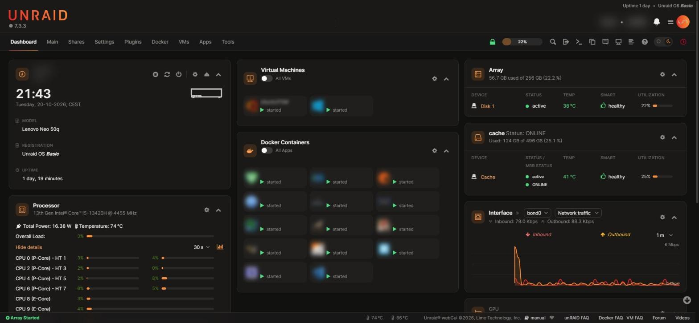

| Light mode | Custom accent |
| --- | --- |
| 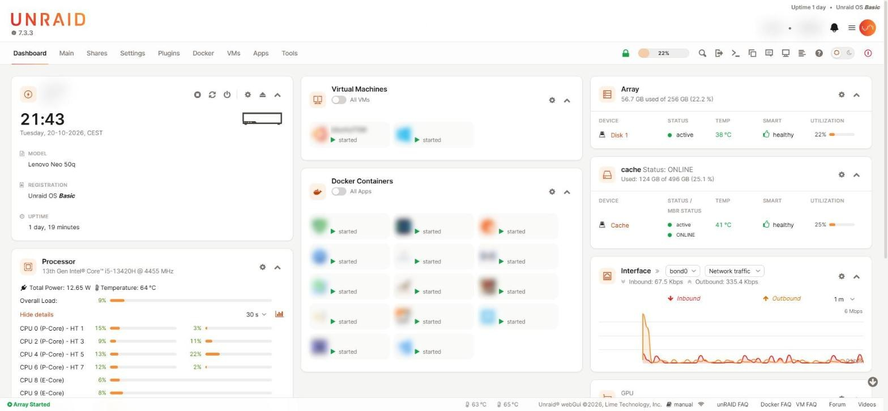 | 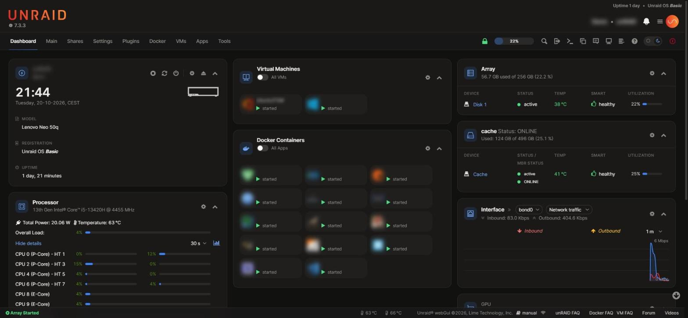 |

## Features

- **Light and dark** — follows *Settings → Display Settings* (white/azure = light, black/gray = dark). A switch in the navigation bar changes it on the fly, for that browser. The Vue header and the notification panel follow it too.
- **Redesigned webGUI** — navigation, tabs, tables, usage meters, forms, buttons, toggles, menus, dialogs and tooltips, with Inter as the interface font.
- **Dashboard** — equal columns, tiles as cards, Docker and VM cards, smooth CPU and network charts, thinner RAM rings with a dedicated palette.
- **Settings → Neoraid** — accent colour, default mode for every browser, density, corners, font, switch on or off, with a live preview.
- **Plugin pages** — Community Applications, Unassigned Devices, Preclear and ZFS Master get dedicated styles; other plugins inherit the theme colours.

## Requirements

Unraid **7.3.0** or later (developed and tested on 7.3.3).

## Install

In Unraid go to **Plugins → Install Plugin**, paste this URL and press **Install**:

```
https://raw.githubusercontent.com/veaceslavmafteiaevoluta/neoraid/main/dist/neoraid.plg
```

Reload the page. Updates show up in **Plugins → Check for Updates**.

## Settings

**Settings → User Preferences → Neoraid**

| Option | Values | What it changes |
| --- | --- | --- |
| Accent colour | 8 presets or any colour | Active page, links, focus, primary buttons, toggles, usage bars, charts |
| Default mode | Follow Display Settings / Light / Dark | The mode every browser starts in; the switch still changes it per browser |
| Density | Comfortable / Compact | Height of table rows and controls |
| Corners | Standard / Sharp / Round | Radius of cards, tables, buttons and fields |
| Font | Inter (included) / System font | Interface typeface |
| Light/dark switch | Show / Hide | The switch in the navigation bar |

Every change previews immediately; **Apply** saves it for all pages and browsers, **Default** restores the initial values. Settings are stored in `/boot/config/plugins/neoraid/neoraid.cfg`.

## Screenshots

| | |
| --- | --- |
| 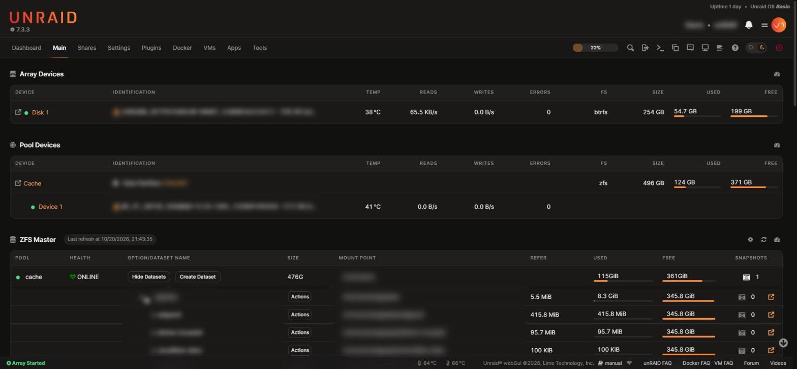 Main | 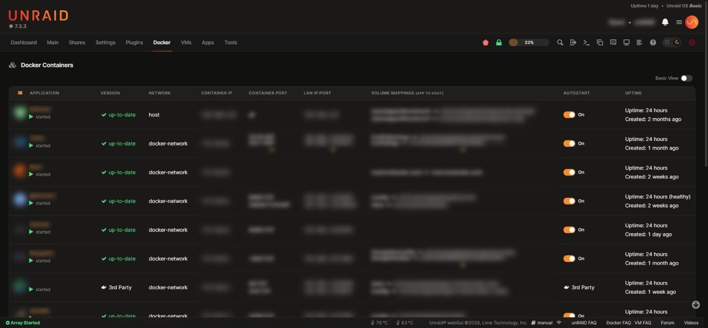 Docker |
| 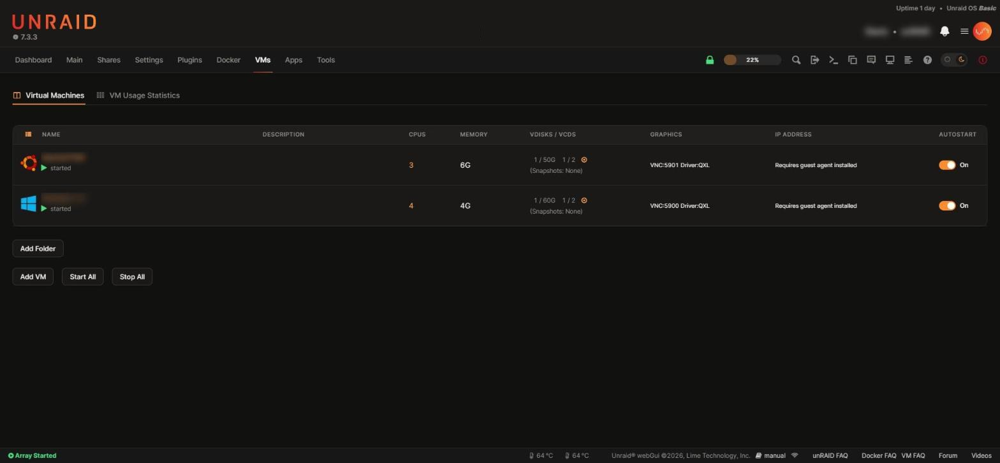 VMs | 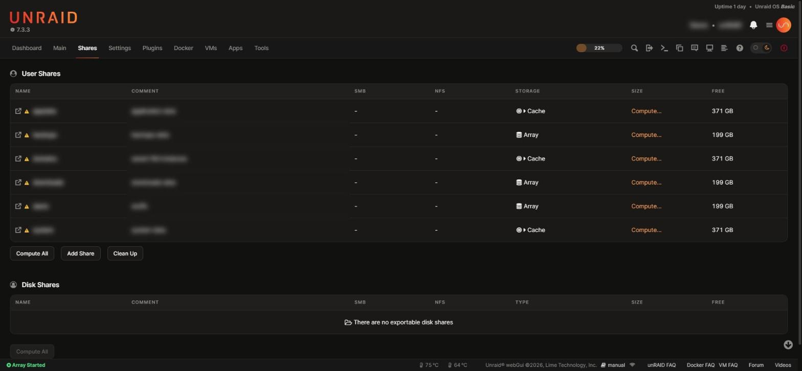 Shares |
| 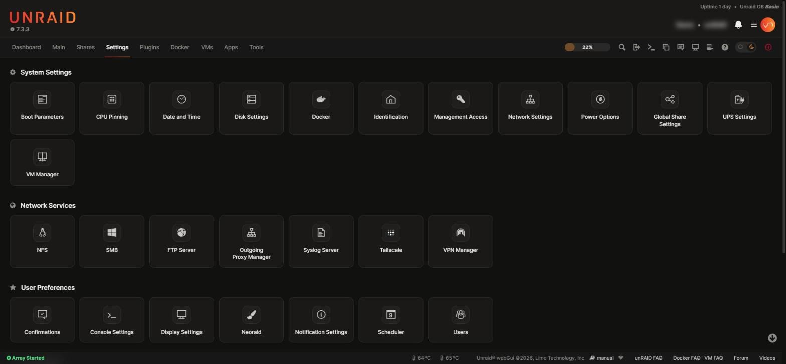 Settings | 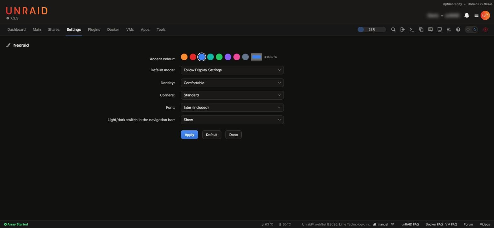 Settings → Neoraid |
| 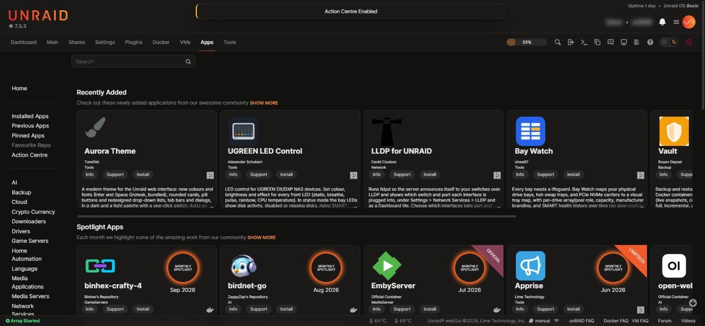 Apps (Community Applications) | 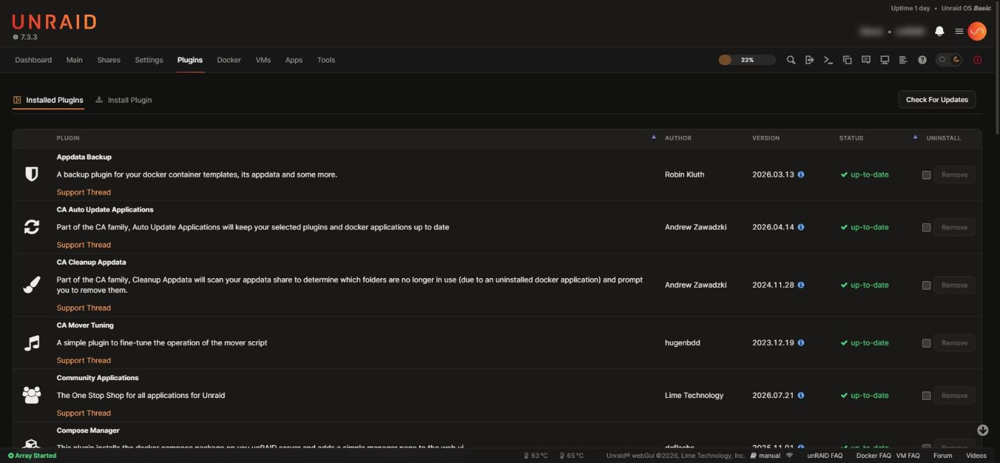 Plugins |
| 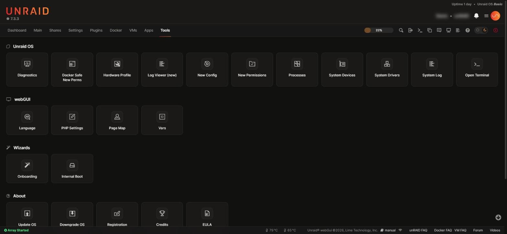 Tools | |

Personal data (server name, container and VM names, shares, disk serials, IP addresses, paths) is blurred.

## Uninstall

**Plugins → Installed Plugins → Neoraid → Remove**, then reload the page. The plugin folder and its settings are deleted and the webGUI looks exactly as before.

## Known limitations

- The login page keeps the stock look: it does not load plugin pages.
- The Vue header keeps its own layout; the theme sets its colours.
- The option list of a native `<select>` is drawn by the operating system.
- App icons and badges in Community Applications are images from the CA feed.
- The sidebar layouts (gray and azure themes) have had less testing than the top navigation.

## Repository

| Path | Contents |
| --- | --- |
| `dist/neoraid.plg` | The plugin, a single self-contained file |
| `src/` | Sources: stylesheet, script, pages, default settings, font |
| `screenshots/` | The images above |
| `assets/` | Logo |

## AI-assisted development

Neoraid was developed with the help of AI ([Claude Code](https://claude.com/claude-code) by Anthropic), used as a coding assistant for the stylesheet, the script, the build tooling and the documentation. Every change was reviewed, installed and checked by hand on a real Unraid 7.3 server, in light and dark mode, before release. Commits written with AI assistance carry a `Co-Authored-By` trailer.

## Credits

- [Inter](https://rsms.me/inter/) by Rasmus Andersson, SIL Open Font License 1.1 (`src/fonts/LICENSE-Inter.txt`), embedded in the plugin.
- Unraid is a trademark of Lime Technology, Inc. Neoraid is an independent project, not affiliated with or endorsed by Lime Technology.

## License

[MIT](LICENSE)
